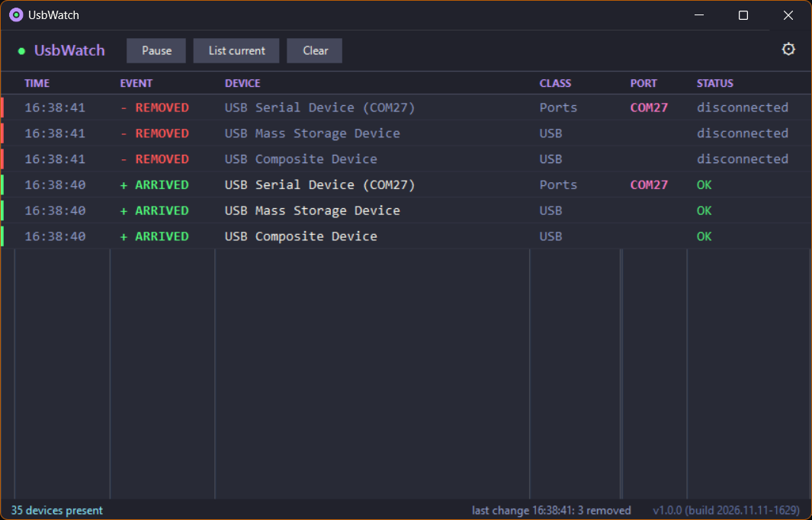

# UsbWatch

A small, dark-themed Windows tool that shows USB devices as they connect and disconnect, and tells you whether they enumerated correctly. It was built for the "did my dev board / drone / flight controller actually show up?" moment, when Device Manager is too slow and too buried.

- **Single source file, no installer, no dependencies.** `Build.bat` compiles it with the C# compiler that already ships with Windows.
- **Live event table.** Every arrival, removal and status change is a timestamped row, newest on top, color-coded: green arrived, red removed, cyan changed, orange problem.
- **Enumeration problems explained.** Windows error codes are spelled out ("ERROR 43: reported problems (enumeration failure)") instead of left as bare numbers.
- **COM ports at a glance.** Serial devices show their `COMn` port in its own column.
- **Quiet notifications.** The first change pops a toast immediately. Everything else in the same burst (a dock or hub produces many events) is collapsed into one summary toast. Clicking a toast brings the window forward.
- **Runs in the tray.** Closing the window can hide it to the tray; right-click the tray icon to exit.
- **Remembers your setup.** Toggles, visible columns and window size/position are saved to `UsbWatch.ini` next to the exe.

## Build and run

Requirements: Windows 10 or 11. The .NET Framework 4.x compiler it uses is part of Windows.

1. Put `UsbWatch.cs`, `Build.bat`, `UsbWatch.ico` and `CHANGELOG.md` in one folder (a local folder like `C:\Tools\UsbWatch` is best, not a cloud-synced one).
2. Double-click `Build.bat`.

The script stops any running copy, compiles `UsbWatch.exe`, launches it, and closes itself after a few seconds. If the build fails it stays open so you can read the compiler error. The status bar and About dialog show the release version plus the exact build date/time, for example `v1.0.0 (build 2026.11.11-1549)`.

## Using it

The toolbar has **Pause**, **List current** (shows what is plugged in right now) and **Clear**. Everything else lives in the gear menu:

| Setting | What it does |
| --- | --- |
| USB devices only | Off watches every Plug and Play device, not just USB |
| Hide sub-interfaces | Hides the extra `MI_xx` rows of composite devices |
| Notifications | Toast notifications on or off |
| Auto-scroll | Jump back to the newest event when rows arrive |
| Log to file | Append everything shown in the list (including "List current" snapshots) to `UsbWatch.log` next to the exe |
| Always on top | Keep the window above others |
| Close to tray | X hides to the tray instead of exiting |
| Columns | Choose any of Time, Event, Device, Class, VID:PID, Port, Status |
| Copy all rows | Copy the whole list to the clipboard |
| About | Version and changelog |

Select rows and press Ctrl+C, or right-click, to copy a row or its full device instance ID.

### Settings file

`UsbWatch.ini` is a plain `Key=1` / `Key=0` text file (plus window position and size). It is safe to edit while the app is closed, and deleting it restores the defaults.

## How it works

Windows device-change messages trigger an immediate refresh, and a 2-second background poll catches changes that happen without a message (for example a driver finishing its install). Each refresh queries `Win32_PnPEntity`, diffs the result against the previous snapshot by device instance ID, and turns the differences into events. Devices reporting error 45 or 21 ("not connected" / "being removed") are treated as already gone.

## Limitations

- It reports devices Windows has created a device entry for. A port that resets without ever creating a device node will not show up; for that, look at the Kernel-PnP log in Event Viewer (`Applications and Services Logs > Microsoft > Windows > Kernel-PnP > Configuration`).
- The executable is unsigned, so Windows SmartScreen may warn the first time you run a copy you built or downloaded ("More info", then "Run anyway").
- Developed and tested on Windows 11. On older Windows 10 builds the dark title bar and scrollbars may stay light.

## Related tools

If you want a long-lived history of every USB device a PC has ever seen, or a more forensic view, NirSoft's [USBLogView](https://www.nirsoft.net/utils/usb_log_view.html) and USBDeview are well established. UsbWatch aims at a different job: a quick, glanceable live view while you plug things in.

## Changelog

See [CHANGELOG.md](CHANGELOG.md). The same file is embedded in the exe and shown in Settings > About, so there is only one copy to maintain.

### Versioning and releases

UsbWatch follows [Semantic Versioning](https://semver.org/). The release version is taken from the newest `## [x.y.z]` heading in the changelog; the build date/time is added automatically on every build.

To cut a release:

1. Add a new `## [x.y.z] - date` section with bullets at the top of `CHANGELOG.md`.
2. Run `Build.bat`.
3. Tag and push: `git tag vx.y.z` then `git push origin vx.y.z`.
4. Create a GitHub Release for the tag and attach `UsbWatch.exe`. Include its SHA-256 in the notes (`Get-FileHash UsbWatch.exe` in PowerShell) so downloaders can verify it.

## Support

UsbWatch is free and open source. If it saves you some time, you can [buy me a coffee](https://buymeacoffee.com/oodles44).

## License

MIT, see [LICENSE](LICENSE).
